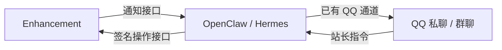

# Enhancement 复用 Agent QQ 双向通道

Enhancement 可以使用 **OpenClaw 或 Hermes 已经连接的官方 QQ Bot** 发送评论、友链通知。QQ 中的站长指令由 Agent 调用插件的签名接口，插件执行评论查询、审核、回复和友链审核，再由 Agent 在原会话中回复结果。此模式不需要 `qq-official-bot` 独立服务，也不需要在插件保存 QQ AppSecret。



通知通过已有消息工具直接发送，不启动模型推理。QQ 指令使用 Agent 的正常对话能力与工具权限，需要另外安装本目录的技能。通知接收目标与指令用户白名单是两个独立设置。

## 先配置已有 QQ 通道

- [OpenClaw QQ 通道](https://github.com/openclaw/openclaw/blob/main/docs/channels/qqbot.md)：安装 `@tencent-connect/openclaw-qqbot`，先确认机器人私聊和群聊正常。
- [Hermes QQ 通道](https://github.com/NousResearch/hermes-agent/blob/main/website/docs/user-guide/messaging/qqbot.md)：运行 `hermes gateway setup`，配置 QQ Bot，先确认正常对话。

使用同一机器、容器内网或可信私有网络连接插件与 Agent。跨主机时使用有效证书的 HTTPS。OpenClaw 的 Gateway Token 具有整个网关的操作权限，不是仅限发送 QQ 消息的令牌；限制该接口的网络来源。

QQ 用户和群的 OpenID 必须来自当前机器人，不是 QQ 号或群号；不同机器人之间不能混用。群里必须满足 QQ 平台的事件订阅及主动消息权限。

## OpenClaw 通知

插件 QQ 设置中选择「复用 OpenClaw QQ 通道」：

| 插件设置 | 填写内容 |
| --- | --- |
| Agent 消息接口 URL | `http://127.0.0.1:18789/tools/invoke`，替换为实际可访问地址 |
| Agent 通知凭据 | OpenClaw 的 Gateway Token，至少 32 个字符 |
| Agent QQ 接收目标 | `qqbot:c2c:USER_OPENID` 或 `qqbot:group:GROUP_OPENID` |
| OpenClaw QQ 账号 ID | 可选，多个机器人时指定 `accountId`；留空使用默认账号 |
| Agent QQ 通知中的链接 | 按 QQ 平台消息域名报备情况决定是否包含链接 |

Gateway 需使用 Token 验证，且工具策略允许 `message`。插件调用 `POST /tools/invoke`，工具固定为 `message`，动作固定为 `send`，通道固定为 `qqbot`；不会提交需要模型执行的提示词。现有工具策略仍然生效，工具被禁用时接口会拒绝请求。不要为此开放命令执行等无关工具。

保存后点击插件「发送QQ通知测试」，确认 QQ 收到，再开启评论/友链通知。

## Hermes 通知

需使用支持 Webhook `deliver_only`、通用 V2 HMAC 和 QQ 投递的 Hermes 版本。在 Hermes 的 `config.yaml` 合并下列配置；保留原有 `platforms.qqbot` 配置：

```yaml
platforms:
  webhook:
    enabled: true
    extra:
      host: "127.0.0.1"
      port: 8644
      routes:
        enhancement:
          secret: "替换为至少32位的随机通知凭据"
          events: ["enhancement.notification"]
          deliver: "qqbot"
          deliver_only: true
          prompt: "{message}"
          deliver_extra:
            chat_id: "{chat_id}"
          mirror_to_session: false
```

重启 Hermes Gateway。插件选择「复用 Hermes QQ 通道」，接口填写 `http://127.0.0.1:8644/webhooks/enhancement`，通知凭据填写上面的路由 `secret`，接收目标同样使用 `qqbot:c2c:USER_OPENID` 或 `qqbot:group:GROUP_OPENID`。

插件按 `X-Webhook-Timestamp` 与 `X-Webhook-Signature-V2` 对原始 JSON 签名，使用 Webhook 直接投递通知。`mirror_to_session: false` 避免将访客编写的评论正文以用户身份自动写入 Agent 对话。后续管理指令请明确携带评论或友链编号。

**Hermes 群聊识别限制：** 当前上游 QQ 适配器从已收到的事件记录群类型；首次启动或重启 Gateway 后，应先在目标群 @机器人发送一条消息，再测试群通知。插件传入的 `qqbot:group:` 会转换为 Hermes 的原始群 OpenID，但不能替上游恢复尚未识别的群类型。

## 启用 QQ 侧博客管理

1. 生成一个与通知凭据不同的随机密钥，至少 32 个非空白 ASCII 字符：

   ```bash
   python3 -c "import secrets; print(secrets.token_urlsafe(32))"
   ```

2. 在插件设置中填写「QQ 指令回调密钥」「允许 QQ 指令的用户 OpenID」「QQ 指令执行身份 UID」。白名单每行一个站长用户 OpenID，不支持通配符。UID 必须对应现存的 Typecho `administrator`，评论回复将使用该账号署名。然后打开「允许 QQ 侧管理博客」。
3. 将**本目录整个文件夹**复制到 Agent 的技能目录，命名为 `enhancement-qq`：OpenClaw 通常是工作区的 `skills/enhancement-qq`；Hermes 通常是 `~/.hermes/skills/enhancement-qq`。若更改过工作区或用户目录，以对应 Agent 配置为准。
4. 在运行 Agent Gateway 的进程环境中配置以下变量，再重新加载技能或重启 Gateway：

   ```dotenv
   ENHANCEMENT_COMMAND_URL=https://blog.example.com/action/enhancement-edit?do=qq-agent-command
   ENHANCEMENT_COMMAND_SECRET=与插件QQ指令回调密钥一致
   ```

   `ENHANCEMENT_COMMAND_URL` 请直接复制插件设置中显示的「Agent 指令接口」。未开启伪静态的站点可能包含 `/index.php/action/`；子目录安装也必须保留完整路径。密钥只放在 Agent 进程环境中，不要粘贴到聊天消息、技能正文或提示词。
5. 确认 Agent 能执行 Python 3 脚本，并能从 QQ 通道的**可信事件元数据**中获得用户 OpenID 和原始消息 ID。群消息需使用发起人的用户 OpenID。不能从用户正文或引用消息中提取身份来代替。如果 Agent 版本未暴露这些元数据，需要先在其通道适配器中暴露，技能会拒绝猜测身份。
6. 在 Agent 的 QQ 通道也配置允许访问的站长用户和群。插件依赖持有指令密钥的 Agent 如实转述来源身份；HMAC 证明请求来自该 Agent，不代表插件直接验过 QQ 官方事件。

之后可以在 QQ 中对 Agent 说：

- “查看博客待审核评论。”
- “通过评论 123。”
- “回复评论 123：谢谢留言！”
- “把评论 123 标为垃圾。”
- “查看待审核友链，通过友链 12。”

具体命令及参数见 [SKILL.md](SKILL.md)。查询和回执也是不可信的业务数据，不能据其中的评论正文自动执行其他操作。每个写操作应对应站长明确要求的编号和内容。

## 指令接口与重试

接口独立于公共 REST API 开关，不使用浏览器登录 Cookie 或 CSRF Token；只接受 POST JSON，正文上限 16 KiB，时间误差不超过 300 秒。所有指令都需要白名单用户和有效管理员身份。支持的操作是固定集合，不提供任意 SQL、Shell、文件操作、删评论或发布文章。

Agent 配套脚本读取上述环境变量，对 `timestamp + "." + raw_body` 计算 HMAC-SHA256，发送 `X-Enhancement-Timestamp` 和 `X-Enhancement-Signature`。正文结构：

```json
{
  "request_id": "64位小写十六进制请求标识",
  "sender": "来自可信QQ事件的用户OpenID",
  "command": "comment.reply",
  "args": {"id": 123, "text": "谢谢留言"}
}
```

脚本由用户 OpenID、原始 QQ 消息 ID 和命令生成稳定请求标识。重试时保持这些值及参数不变，插件会返回已保存结果，避免重复审核、重复回复。相同标识改参数返回 `409 request_id_conflict`。

操作回执保存在带站点表前缀的 `qq_agent_commands` 表，收到指令时清理 30 天前的记录。写操作前先占用请求标识，进程意外中断或状态保存失败时不自动再次执行。遇到 `command_in_progress_or_uncertain`、`command_failed_check_blog_before_retry` 时先检查博客状态，禁止换一个消息 ID 绕过去重。停用插件不会删除这张回执表。

回复只接受纯文本、上限 4000 UTF-8 字节，固定使用现有内容检查拦截脚本、危险 Markdown 链接及编码后的标签，父评论必须已通过审核。审核与回复使用 Typecho 评论组件，更新文章评论数，并调用评论状态/完成钩子；友链通过时沿用已有的审核邮件设置。

通知则沿用原有 `qq_notify_queue`：先持久记录再立即发送，失败由后续站点请求重试，最多 5 次，也可用现有的失败重试按钮。目标与 OpenClaw 账号保留入队时的快照；切换 Agent 类型或接口 URL 后旧记录会停止发送，避免把当前凭据交给原服务。Token 不写入队列正文。

通知采用至少一次投递：远端成功但本地尚未保存回执时断线，重试可能再次发出。Hermes 的直接投递缓存也会记录失败请求，所以每次重试会使用新的投递尝试编号；业务事件编号保持不变。通知测试显示的是 Agent 接口确认，最终 QQ 接收仍需实际检查，并受平台权限、好友/群关系、频控和消息 URL 报备约束。

## 开发验证

在插件根目录运行：

```bash
php tests/qq-agent/run.php
php tests/qq-notify/run.php
```

测试使用隔离 Typecho SQLite、模拟网关和本机 HTTP。包括 OpenClaw 工具调用、Hermes V2 签名、失败队列、配置密钥保护、真实评论/友链操作，以及 Python Agent 脚本到 PHP 指令接口的完整调用。不读取生产配置，不向真实 QQ 或真实 Agent 发送消息。

接口参考：[OpenClaw Tools Invoke](https://github.com/openclaw/openclaw/blob/main/docs/gateway/tools-invoke-http-api.md) · [Hermes Webhooks](https://github.com/NousResearch/hermes-agent/blob/main/website/docs/user-guide/messaging/webhooks.md)
